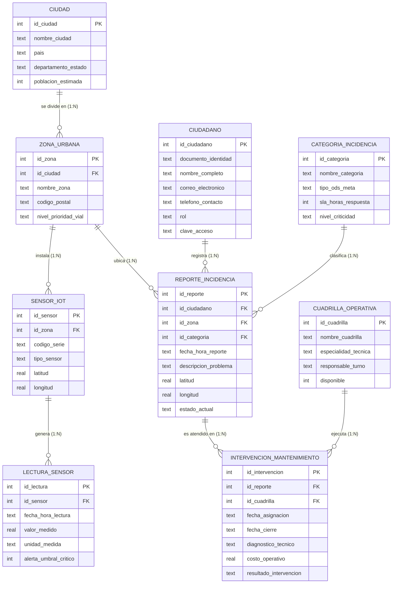

# 🏙️ SmartCity DataHub · Bucaramanga (ODS 11)


**Sistema Integrado de Base de Datos Relacional para el Monitoreo de Incidencias Viales, Movilidad y Calidad Ambiental Urbana en Bucaramanga, Santander.**

> 📚 **Proyecto Integrador · Metodología COIL**
> * **Institución:** Unidades Tecnológicas de Santander (UTS) – Colombia
> * **Asignatura:** Bases de Datos / Modelado de Datos (8.° Semestre)
> * **Autor:** Jonathan Alexis Guevara Basto
> * **Docente Líder:** Ing. Ricardo Andrés Medina Puentes

---

## 📌 Propósito del Proyecto

En ciudades intermedias como **Bucaramanga y su Área Metropolitana**, los reportes ciudadanos sobre daños viales (huecos, hundimientos), fallas en la red semafórica y alertas de contaminación del aire suelen gestionarse en canales aislados (hojas de cálculo, redes sociales y líneas telefónicas), provocando duplicidad de registros y demoras en los tiempos de atención municipal.

**SmartCity DataHub** soluciona esta problemática mediante:
1. Un **Modelo Entidad-Relación (MER) normalizado en Tercera Forma Normal (3FN)** con **9 entidades conectadas** e integridad referencial estricta (`PK` / `FK`).
2. **Portal Público e Interfaz Cartográfica (Leaflet + OpenStreetMap):** Visualización georreferenciada de incidencias ciudadanas y estaciones de monitoreo sobre el mapa de Bucaramanga.
3. **Telemetría IoT en Tiempo Real (API Open-Meteo):** Consulta en vivo de material particulado (`PM2.5`, `PM10`) y monóxido de carbono vehicular (`CO`) en las coordenadas reales de cada comuna.
4. **Control de Acceso Basado en Roles (`Ciudadano` y `Administrador`):** Tres módulos **CRUD independientes** (Reportes, Cuadrillas Operativas y Usuarios) con despacho técnico y control de costos.

---

## 📐 Arquitectura de la Base de Datos (Modelo Entidad-Relación - MER)

El motor relacional (`schema.sql`) implementa las siguientes **9 entidades en 3FN**:



---

## 🚀 Guía de Instalación Paso a Paso (Local)

Sigue estos pasos para clonar y ejecutar el proyecto en cualquier computador (**Windows, Linux o macOS**):

### 1. Requisitos previos
* Tener instalado **[Python 3.9 o superior](https://www.python.org/downloads/)** *(en Windows, marcar la casilla **"Add Python to PATH"** durante la instalación)*.
* Tener instalado **[Git](https://git-scm.com/downloads)**.
* Conexión a internet *(para cargar los mapas de OpenStreetMap y las lecturas reales de la API de Open-Meteo)*.

### 2. Clonar el repositorio
Abre una terminal (**PowerShell**, **CMD** o **Bash**) y ejecuta:

```bash
git clone https://github.com/ryoka0123/smartcity-datahub.git
cd smartcity-datahub
```

### 3. Crear y activar el entorno virtual (`.venv`)

* **En Windows (PowerShell):**
  ```powershell
  python -m venv .venv
  .\.venv\Scripts\Activate.ps1
  ```
  > 💡 *Nota:* Si PowerShell muestra un aviso de permisos al activar el entorno, ejecuta una sola vez:
  > `Set-ExecutionPolicy -Scope CurrentUser RemoteSigned`
  > *(O simplemente usa el archivo `iniciar_app.bat` incluido en la carpeta).*

* **En Linux / macOS:**
  ```bash
  python3 -m venv .venv
  source .venv/bin/activate
  ```

### 4. Instalar las dependencias
```bash
pip install -r requirements.txt
```

### 5. Iniciar el servidor
```bash
python app.py
```
Abre tu navegador en: 👉 **[http://127.0.0.1:5000](http://127.0.0.1:5000)**

*(La primera vez que arranca, la aplicación ejecuta automáticamente `schema.sql` y `seed.sql`, creando el archivo `smartcity.db` con las 9 tablas y los datos iniciales de Bucaramanga).*

---

## 🔐 Roles del Sistema y Credenciales de Acceso

La aplicación inicia en un **Portal Urbano Público (`Index`)** donde cualquier visitante puede explorar el mapa de Bucaramanga y el estado de los sensores. Para interactuar con los módulos CRUD existen dos roles diferenciados:

| Rol | Usuario / Correo | Documento | Contraseña | Permisos en el Sistema |
| :--- | :--- | :--- | :--- | :--- |
| 👨‍💼 **Administrador** | `jonathan@correo.uts.edu.co` | `1098000001` | `uts2026` | Acceso total: **CRUD General de Reportes**, despacho de cuadrillas, cierre de intervenciones con costos, **CRUD de Cuadrillas**, **CRUD de Usuarios** e **Inspector SQL en vivo del MER (`/modelo-datos`)**. |
| 🙋‍♀️ **Ciudadano** | `maria.rojas@correo.com` | `1098000002` | `123456` | Acceso al **Portal del Ciudadano**: creación de nuevos reportes georreferenciados en el mapa y edición/eliminación únicamente de sus propios reportes. |

*(También puedes crear nuevas cuentas desde la vista **`/registro`**).*

---

## 📡 Telemetría IoT en Tiempo Real (Bucaramanga)

El módulo `/sensores` consulta en tiempo real la API pública satelital y de estaciones de **[Open-Meteo Air Quality](https://open-meteo.com/en/docs/air-quality-api)** usando las coordenadas GPS de Bucaramanga:

1. **`SEN-BGA-01` (Ciudadela Real de Minas – UTS · `7.1050, -73.1230`):** Mide **Calidad del aire PM2.5 (`µg/m³`)**.
2. **`SEN-BGA-02` (Centro de Bucaramanga · `7.1190, -73.1230`):** Mide **Emisión vehicular de Monóxido de Carbono CO (`µg/m³`)**.
3. **`SEN-BGA-03` (Cabecera del Llano · `7.1180, -73.1110`):** Mide **Material particulado PM10 (`µg/m³`)**.

---

## 📁 Estructura del Proyecto

```text
smartcity-datahub/
├── app.py                  # Servidor Flask, rutas, autenticación por roles y conexión a API Open-Meteo
├── schema.sql              # DDL SQLite: creación de las 9 tablas del MER con PK, FK y CHECKs (3FN)
├── seed.sql                # DML: datos iniciales de Bucaramanga (comunas, sensores, cuadrillas y reportes)
├── requirements.txt        # Dependencias del proyecto (Flask, Gunicorn)
├── Procfile                # Configuración de arranque para despliegue en la nube
├── render.yaml             # Especificación de despliegue automático en Render.com
├── iniciar_app.bat         # Script de inicio rápido con doble clic para Windows
├── static/
│   └── style.css           # Hoja de estilos moderna (Inter UI, tarjetas, badges y diseño responsive)
└── templates/
    ├── base.html           # Barra de navegación dinámica según rol (Público, Ciudadano, Administrador)
    ├── dashboard.html      # Index público / Panel principal con KPIs y mapa multicapa (Reportes + Sensores)
    ├── login.html          # Vista independiente de inicio de sesión
    ├── registro.html       # Vista independiente de creación de cuenta ciudadana/administrativa
    ├── reportes.html